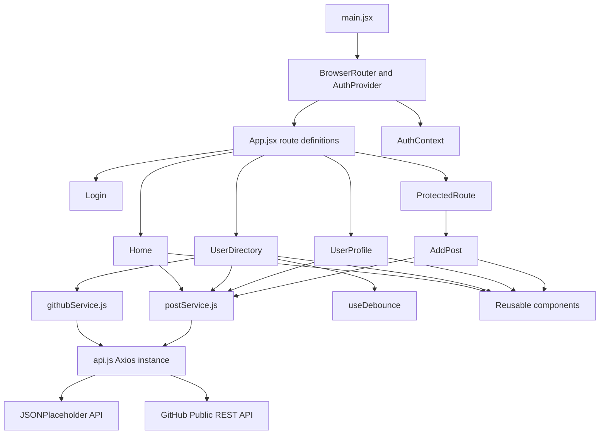

# DevDirectory — Project Report Working Template

**Student name:** Rachit Ahirwar  
**Roll number:** R57661  
**Institution:** Jaipur National University  
**Course:** BCA — Modern Frontend Frameworks  
**Project title:** DevDirectory

> This is a working outline only. Complete the final printable report after the app is tested and actual screenshots have been captured. Do not describe screenshots or test outcomes that have not been produced.

## 1. Objective
Build a responsive single-page application where users can search developers, inspect developer profiles and their posts, and publish a post through a protected simulated session.

## 2. Technology stack
- React 18+
- React Router v6+
- Axios configured client
- React Context for mock authentication
- CSS and responsive layout
- JSONPlaceholder demonstration API (required assignment endpoints)
- GitHub public REST API for genuine GitHub developer profiles (using the same configured Axios client)

## 3. Architecture and data flow


## 4. Main features
1. Home overview with API-derived statistics and latest posts.
2. Directory with two data sources: real public GitHub profiles (live details and direct account links) and the required JSONPlaceholder assignment dataset. The assignment source uses debounced search by developer name or company.
3. Dynamic developer profile and user-specific posts.
4. Mock login/signup with context state and guarded post creation.
5. Controlled post form with dynamic author options, character limits, API submission, HTTP 201 success handling, and reset behavior.
6. Loading skeletons, dismissible retryable alerts, responsive navigation, and 404 handling.

## 5. Screenshots to capture after validation
- [ ] Home page — desktop
- [ ] Real GitHub profile directory — desktop
- [ ] Assignment API directory and “Leanne” search — desktop
- [ ] Developer directory — mobile
- [ ] Loading state
- [ ] Error state with Retry button
- [ ] Redirect from `/add-post` to `/login` and return after login
- [ ] Post form validation and HTTP 201 success state
- [ ] Invalid developer ID / 404 behavior

## 6. Testing and self-evaluation
Complete this table with actual test outcomes after manually exercising the application.

| Requirement | Expected outcome | Actual result / evidence |
|---|---|---|
| Search by developer name or company | Only matching cards are shown without a page reload | To be tested |
| Protected route | Unauthenticated access redirects to `/login` and retains requested destination | To be tested |
| API lifecycle | Loading state is shown; API failure produces dismissible alert with Retry | To be tested |
| Controlled post form | Invalid fields prevent submission; valid form sends `{ title, body, userId }` | To be tested |
| HTTP 201 handling | Green confirmation appears and the form resets | To be tested |
| Production build | `npm run build` succeeds and preview opens | To be tested |

## 7. Limitations
Authentication is simulated on the frontend. JSONPlaceholder is a sample API and does not permanently store submitted posts. GitHub public REST API requests may be rate-limited for unauthenticated users; real account links remain direct GitHub links. These constraints should be stated in the final report.

## 8. Execution commands
```bash
npm install
npm run dev
npm run build
npm run preview
```
